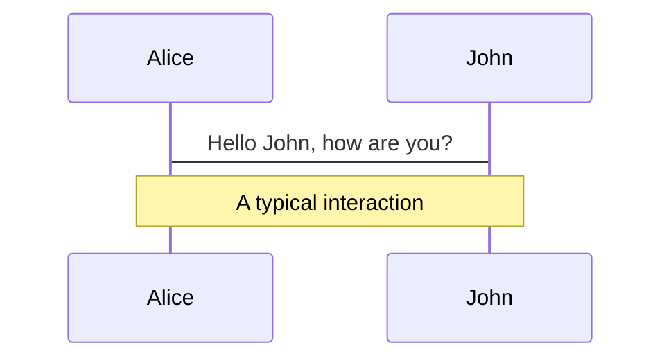
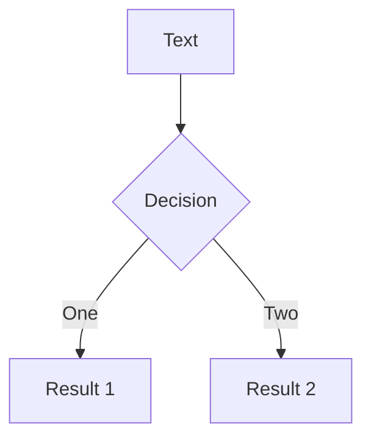
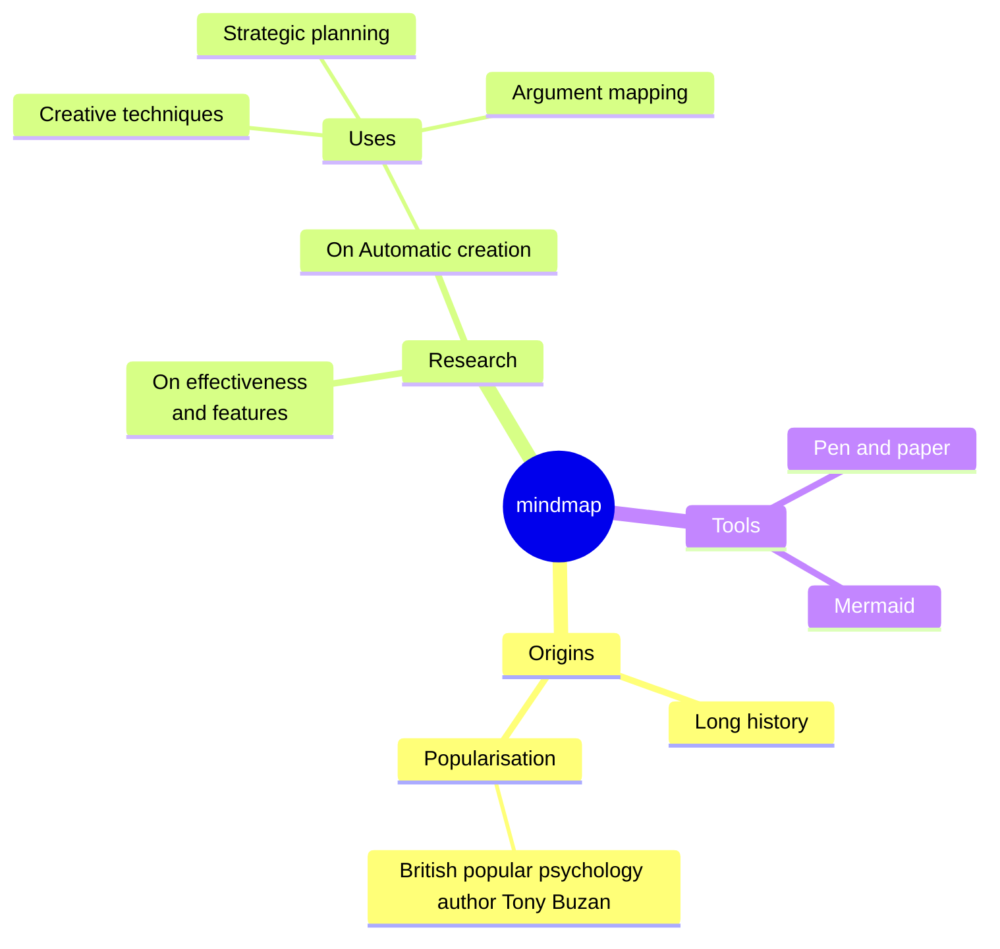
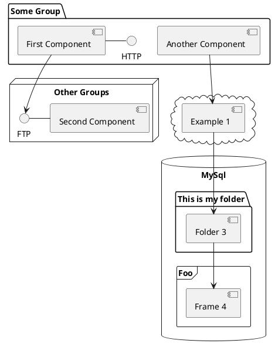

---
# try also 'default' to start simple
routerMode: hash
theme: scholarly
# random image from a curated Unsplash collection by Anthony
# like them? see https://unsplash.com/collections/94734566/slidev
background: https://cover.sli.dev
# some information about your slides (markdown enabled)
title: Welcome to Slidev
info: |
  ## Slidev Starter Template
  Presentation slides for developers.

  Learn more at [Sli.dev](https://sli.dev)
# apply UnoCSS classes to the current slide
class: text-center
# https://sli.dev/features/drawing
drawings:
  persist: false
# slide transition: https://sli.dev/guide/animations.html#slide-transitions
transition: slide-left
# enable Comark Syntax: https://comark.dev/syntax/markdown
comark: true
# duration of the presentation
duration: 35min
authors:
  - name: Arjun Varma R
    institution: Université de Lorraine
  - name: Ahmed Dimokrati
    institution: Mohammed VI Polytechnic University, Morocco
  - name: Maeva Cottura
    institution: Université de Lorraine
  - name: Benoît Appolaire
    institution: Université de Lorraine
footerMiddle: Matériaux 2026
themeConfig:
  colorTheme: classic-blue
  fontTheme: modern
  chromeMode: dark
  sectionMode: dark
aspectRatio: 4/3
fontsize:
  body: 16px
  h1: 46px
  h2: 34px
  h3: 26px
---

# Discontinuous Precipitation

A elasticity-coupled multi-phase field investigation

<!--
<div @click="$slidev.nav.next" class="mt-12 py-1" hover:bg="white op-10">
  Press Space for next page <carbon:arrow-right />
</div>
-->

<div class="abs-br m-6 text-xl">
  <button @click="$slidev.nav.openInEditor()" title="Open in Editor" class="slidev-icon-btn">
    <carbon:edit />
  </button>
  <a href="https://github.com/slidevjs/slidev" target="_blank" class="slidev-icon-btn">
    <carbon:logo-github />
  </a>
</div>

<!--
The last comment block of each slide will be treated as slide notes. It will be visible and editable in Presenter Mode along with the slide. [Read more in the docs](https://sli.dev/guide/syntax.html#notes)
-->

---
transition: slide-left
layout:center
---

# Analyzing discontinuous precipitation


<div class="slide-content">
There are three types of simulations now:

 - Straight grain boundary (600 x 150) $c_0 = 0.2$   
 - Straight grain boundary (600 x 300) $c_0 = 0.2$ 
 - Curved grain boundary (600 x 600)   $c_0 = 0.2$ 
</div>

<style>
.slide-content {
  position: absolute;
  top: 35%;
  bottom: 3%;
  left: 5%;
  right: 2%;
  display: flex;
  flex-direction: column;
  gap: 0.4rem;
  min-height: 0;
}

.bullet-center {
  flex: 3;
  min-height: 0;
  display: flex;
  align-items: center;
  justify-content: center;
}

.bullet-center ul {
  width: 100%;
  margin: 0;
  padding-left: 1.4em;
}

.bullet-center li {
  margin-bottom: 0.25em;
}
</style>

<!--
You can have `style` tag in markdown to override the style for the current page.
Learn more: https://sli.dev/features/slide-scope-style
-->

<!--
<style>
h1 {
  background-color: #2B90B6;
  background-image: linear-gradient(45deg, #4EC5D4 10%, #146b8c 20%);
  background-size: 100%;
  -webkit-background-clip: text;
  -moz-background-clip: text;
  -webkit-text-fill-color: transparent;
  -moz-text-fill-color: transparent;
}
</style>
-->

<!--
Here is another comment.
-->

---
transition: slide-left
layout:center
---
 
# Summary of the results

<div class="slide-content">

- Coherent-Coherent (CC) leads to flat precipitates growing equally in both directions but with no grain boundary migration.
- Incoherent-Incoherent (II) also leads to equal growth in both grains although with a more rounded shape of the tips.
- Coherent-Incoherent (CI) cases have a GB migration even for initially straight GBs, in the direction of growth of incoherent boundary.
- For a smaller eigenstrain, the flattening of precipitates along the horizontal direction is not pronounced.
- The key questions to be answered are: 
    - what makes the grain boundary migrate for the coherent-incoherent (CI) case?
    - what is the effect of particle spacing on the grain boundary bending?
    - what is the effect of the curved grain boundary?

</div>

<style>
.slide-content {
  position: absolute;
  top: 25%;
  bottom: 3%;
  left: 5%;
  right: 2%;
  display: flex;
  flex-direction: column;
  gap: 0.4rem;
  min-height: 0;
}
</style>
---
transition: slide-left
layout: default
---
# Precipitate evolution: CC and II cases

<div class="slide-content">

  <div class="gif-grid">
    <div class="gif-cell">
      <Mathlabel expr="\mathrm{II}:\ \epsilon^0_{11}=0.04,\ \sigma_{in}=0.75\;\mathrm{mJ}/\mathrm{m}^2" />
      
    </div>
    <div class="gif-cell">
      <Mathlabel expr="\mathrm{II}:\ \epsilon^0_{11}=0.04,\ \sigma_{in}=1.0\;\mathrm{mJ}/\mathrm{m}^2" />
      
    </div>
    <div class="gif-cell">
      <Mathlabel expr="\mathrm{CC}:\ \epsilon^0_{11}=0.04,\ \sigma_{coh}=0.3\;\mathrm{mJ}/\mathrm{m}^2" />
      
    </div>
    <div class="gif-cell">
      <Mathlabel expr="\mathrm{CC}:\ \epsilon^0_{11}=0.04,\ \sigma_{coh}=0.6\;\mathrm{mJ}/\mathrm{m}^2" />
      
    </div>
  </div>

  <div class="bullet-center">
    <ul>
      <li>PB energies are identical between the top and bottom rows.</li>
      <li>Elastic energy differences arise from the coherent versus incoherent precipitate boundaries.</li>
    </ul>
  </div>

</div>

<style>
/* =========================
   Common slide layout
   ========================= */

.slide-content {
  position: absolute;
  top: 20%;
  bottom: 3%;
  left: 5%;
  right: 2%;

  display: flex;
  flex-direction: column;
  gap: 0.4rem;
  min-height: 0;
}


/* =========================
   Four-GIF grid
   ========================= */

.gif-grid {
  flex: 7;
  min-height: 0;

  display: grid;
  grid-template-columns: repeat(2, minmax(0, 1fr));
  grid-template-rows: repeat(2, minmax(0, 1fr));
  gap: 8px;
}

.gif-cell {
  display: flex;
  flex-direction: column;
  align-items: center;
  justify-content: center;

  min-width: 0;
  min-height: 0;
  overflow: hidden;
}

.gif-cell img {
  display: block;

  width: 100%;
  height: 0;
  flex: 1;

  min-height: 0;
  object-fit: contain;
}


/* =========================
   Bullet section
   ========================= */

.bullet-center {
  flex: 3;
  min-height: 0;

  display: flex;
  align-items: center;
  justify-content: center;
}

.bullet-center ul {
  width: 100%;
  margin: 0;
  padding-left: 1.4em;
}

.bullet-center li {
  margin-bottom: 0.25em;
}
</style>

---
transition: slide-left
---

# What about the supersaturation?

<div class="slide-content">

  <div class="gif-grid">
    <div class="gif-cell">
      <Mathlabel expr="\mathrm{II}:\ \epsilon^0_{11}=0.04,\ \sigma_{in}=0.75\;\mathrm{mJ}/\mathrm{m}^2" />
      
    </div>
    <div class="gif-cell">
      <Mathlabel expr="\mathrm{II}:\ \epsilon^0_{11}=0.04,\ \sigma_{in}=1.0\;\mathrm{mJ}/\mathrm{m}^2" />
      
    </div>
    <div class="gif-cell">
      <Mathlabel expr="\mathrm{CC}:\ \epsilon^0_{11}=0.04,\ \sigma_{coh}=0.3\;\mathrm{mJ}/\mathrm{m}^2" />
      
    </div>
    <div class="gif-cell">
      <Mathlabel expr="\mathrm{CC}:\ \epsilon^0_{11}=0.04,\ \sigma_{coh}=0.6\;\mathrm{mJ}/\mathrm{m}^2" />
      
    </div>

  </div>

</div>

<style>
.slide-content {
  position: absolute;
  top: 20%;
  bottom: 3%;
  left: 5%;
  right: 2%;

  display: flex;
  flex-direction: column;
  gap: 0.4rem;
  min-height: 0;
}


/* =========================
   Gif Grid 2x2
   ========================= */

.gif-grid {
  flex: 7;
  min-height: 0;
  display: grid;
  grid-template-columns: repeat(2, minmax(0, 1fr));
  grid-template-rows: repeat(2, minmax(0, 1fr));
  gap: 8px;
}

.gif-cell {
  display: flex;
  flex-direction: column;
  align-items: center;
  justify-content: center;
  min-width: 0;
  min-height: 0;
  overflow: hidden;
}

.gif-cell img {
  display: block;
  width: 100%;
  height: 0;
  flex: 1;
  min-height: 0;
  object-fit: contain;
}

</style>

---
transition: slide-left
---
# Interfacial curvature and concentration

#### $\mathrm{II}:\ \epsilon^0_{11}=0.04,\ \sigma_{in}=0.75\;\mathrm{mJ}/\mathrm{m}^2 (\mathrm{above}),\; \sigma_{in}=1.0\;\mathrm{mJ}/\mathrm{m}^2 (\mathrm{below})$
<div class="grid grid-rows-2 gap-2">
  
  
</div>

---
transition: slide-left
---
# Interfacial curvature and concentration

#### $\mathrm{CC}:\ \epsilon^0_{11}=0.04,\ \sigma_{in}=0.3\;\mathrm{mJ}/\mathrm{m}^2 (\mathrm{above}),\; \sigma_{in}=0.6\;\mathrm{mJ}/\mathrm{m}^2 (\mathrm{below})$
<div class="grid grid-rows-2 gap-2">
  
  
</div>


---
transition: slide-left
---


# And von Mises stress?

<div class="slide-content">

  <div class="gif-grid">
    <div class="gif-cell">
      <Mathlabel expr="\mathrm{II}:\ \epsilon^0_{11}=0.04,\ \sigma_{in}=0.75\;\mathrm{mJ}/\mathrm{m}^2" />
      
    </div>
    <div class="gif-cell">
      <Mathlabel expr="\mathrm{II}:\ \epsilon^0_{11}=0.04,\ \sigma_{in}=1.0\;\mathrm{mJ}/\mathrm{m}^2" />
      
    </div>
    <div class="gif-cell">
      <Mathlabel expr="\mathrm{CC}:\ \epsilon^0_{11}=0.04,\ \sigma_{coh}=0.3\;\mathrm{mJ}/\mathrm{m}^2" />
      
    </div>
    <div class="gif-cell">
      <Mathlabel expr="\mathrm{CC}:\ \epsilon^0_{11}=0.04,\ \sigma_{coh}=0.6\;\mathrm{mJ}/\mathrm{m}^2" />
      
    </div>

  </div>

</div>

<style>
.slide-content {
  position: absolute;
  top: 20%;
  bottom: 3%;
  left: 5%;
  right: 2%;

  display: flex;
  flex-direction: column;
  gap: 0.4rem;
  min-height: 0;
}


/* =========================
   Gif Grid 2x2
   ========================= */

.gif-grid {
  flex: 7;
  min-height: 0;
  display: grid;
  grid-template-columns: repeat(2, minmax(0, 1fr));
  grid-template-rows: repeat(2, minmax(0, 1fr));
  gap: 8px;
}

.gif-cell {
  display: flex;
  flex-direction: column;
  align-items: center;
  justify-content: center;
  min-width: 0;
  min-height: 0;
  overflow: hidden;
}

.gif-cell img {
  display: block;
  width: 100%;
  height: 0;
  flex: 1;
  min-height: 0;
  object-fit: contain;
}

</style>

---
transition: slide-left
---
# And von Mises stress?

<div class="slide-content">

  <div class="gif-grid">
    <div class="gif-cell">
      <Mathlabel expr="\mathrm{II}:\ \epsilon^0_{11}=0.04,\ \sigma_{in}=0.75\;\mathrm{mJ}/\mathrm{m}^2" />
      
    </div>
    <div class="gif-cell">
      <Mathlabel expr="\mathrm{II}:\ \epsilon^0_{11}=0.04,\ \sigma_{in}=1.0\;\mathrm{mJ}/\mathrm{m}^2" />
      
    </div>
    <div class="gif-cell">
      <Mathlabel expr="\mathrm{CC}:\ \epsilon^0_{11}=0.04,\ \sigma_{coh}=0.3\;\mathrm{mJ}/\mathrm{m}^2" />
      
    </div>
    <div class="gif-cell">
      <Mathlabel expr="\mathrm{CC}:\ \epsilon^0_{11}=0.04,\ \sigma_{coh}=0.6\;\mathrm{mJ}/\mathrm{m}^2" />
      
    </div>

  </div>

</div>

<style>
.slide-content {
  position: absolute;
  top: 20%;
  bottom: 3%;
  left: 5%;
  right: 2%;

  display: flex;
  flex-direction: column;
  gap: 0.4rem;
  min-height: 0;
}


/* =========================
   Gif Grid 2x2
   ========================= */

.gif-grid {
  flex: 7;
  min-height: 0;
  display: grid;
  grid-template-columns: repeat(2, minmax(0, 1fr));
  grid-template-rows: repeat(2, minmax(0, 1fr));
  gap: 8px;
}

.gif-cell {
  display: flex;
  flex-direction: column;
  align-items: center;
  justify-content: center;
  min-width: 0;
  min-height: 0;
  overflow: hidden;
}

.gif-cell img {
  display: block;
  width: 100%;
  height: 0;
  flex: 1;
  min-height: 0;
  object-fit: contain;
}

</style>

--


---
transition: slide-left
---

# Coherent - Incoherent (CI)


<div class="slide-content">

  <div class="gif-grid">
    <div class="gif-cell">
      <Mathlabel expr="\mathrm{CI}:\ \epsilon^0_{11}=0.04,\ \sigma_{in}=0.3\;\mathrm{mJ}/\mathrm{m}^2,\ \sigma_{coh}=0.3\;\mathrm{mJ}/\mathrm{m}^2" />
      
    </div>
 <div class="gif-cell">
      <Mathlabel expr="\mathrm{CI}:\ \epsilon^0_{11}=0.04,\ \sigma_{in}=0.6\;\mathrm{mJ}/\mathrm{m}^2,\ \sigma_{coh}=0.6\;\mathrm{mJ}/\mathrm{m}^2" />
      
    </div>
 <div class="gif-cell">
      <Mathlabel expr="\mathrm{Concentration\;Profile}" />
      
    </div>
 <div class="gif-cell">
      <Mathlabel expr="\mathrm{Concentration\;Profile}" />
      
    </div>
    </div>
  </div>


<style>
.slide-content {
  position: absolute;
  top: 15%;
  bottom: 3%;
  left: 5%;
  right: 2%;

  display: flex;
  flex-direction: column;
  gap: 0.6rem;
  min-height: 0;
}


/* =========================
   Gif Grid 2x2
   ========================= */

.gif-grid {
  flex: 7;
  min-height: 0;
  display: grid;
  grid-template-columns: repeat(2, minmax(0, 1fr));
  grid-template-rows: repeat(2, minmax(0, 1fr));
  gap: 4px;
}

.gif-cell {
  display: flex;
  flex-direction: column;
  align-items: center;
  justify-content: center;
  min-width: 0;
  min-height: 0;
  overflow: hidden;
}

.gif-cell img {
  display: block;
  width: 100%;
  height: 0;
  flex: 1;
  min-height: 0;
  object-fit: contain;
}

</style>


---
transition: slide-left
---

# Coherent - Incoherent (CI) cntd...

<div class="grid grid-rows-2 gap-2">
  
  
</div>


---
transition: slide-left
---

# Coherent - Incoherent (CI) cntd...

<div class="slide-content">

  <div class="gif-grid">
    <div class="gif-cell">
      <Mathlabel expr="\mathrm{CI}:\ \epsilon^0_{11}=0.04,\ \sigma_{in}=0.3\;\mathrm{mJ}/\mathrm{m}^2,\ \sigma_{coh}=0.3\;\mathrm{mJ}/\mathrm{m}^2" />
      
    </div>
 <div class="gif-cell">
      <Mathlabel expr="\mathrm{CI}:\ \epsilon^0_{11}=0.04,\ \sigma_{in}=0.6\;\mathrm{mJ}/\mathrm{m}^2,\ \sigma_{coh}=0.6\;\mathrm{mJ}/\mathrm{m}^2" />
      
    </div>
 <div class="gif-cell">
      <Mathlabel expr="\mathrm{von\;Mises\;stress\;Profile}" />
      
    </div>
 <div class="gif-cell">
      <Mathlabel expr="\mathrm{von\;Mises\;stress\;Profile}" />
      
    </div>
    </div>
  </div>


<style>
.slide-content {
  position: absolute;
  top: 15%;
  bottom: 3%;
  left: 5%;
  right: 2%;

  display: flex;
  flex-direction: column;
  gap: 0.6rem;
  min-height: 0;
}


/* =========================
   Gif Grid 2x2
   ========================= */

.gif-grid {
  flex: 7;
  min-height: 0;
  display: grid;
  grid-template-columns: repeat(2, minmax(0, 1fr));
  grid-template-rows: repeat(2, minmax(0, 1fr));
  gap: 4px;
}

.gif-cell {
  display: flex;
  flex-direction: column;
  align-items: center;
  justify-content: center;
  min-width: 0;
  min-height: 0;
  overflow: hidden;
}

.gif-cell img {
  display: block;
  width: 100%;
  height: 0;
  flex: 1;
  min-height: 0;
  object-fit: contain;
}

</style>

---
transition: slide-left
---

# When the difference is only coherency

#### Ahmed's simulation: $\epsilon^0_{11} = 0.04, \sigma = 0.267 \mathrm{J}/\mathrm{m}^2$

<div class="grid grid-rows-1 gap-0">
  
</div>

---
transition: slide-left
---

# When the difference is only coherency.

#### Ahmed's simulation: $\epsilon^0_{11} = 0.04, \sigma = 0.267 \mathrm{J}/\mathrm{m}^2$

<div class="grid grid-rows-1 gap-0">
  
</div>


---
transition: slide-left
---
# Curved Grain Boundary
#### CC: $\epsilon^0_{11} = 0.02,\;\sigma=0.3\mathrm{J}/\mathrm{m}^2$  (above), CI:  $\epsilon^0_{11} = 0.04,\;\sigma=0.6\mathrm{J}/\mathrm{m}^2$  (below)
<div class="grid grid-rows-2 gap-4">
  
  
</div>

---
transition: slide-left
---

# Table of contents

You can use the `Toc` component to generate a table of contents for your slides:

```html
<Toc minDepth="1" maxDepth="1" />
```

The title will be inferred from your slide content, or you can override it with `title` and `level` in your frontmatter.

::right::

<Toc text-sm minDepth="1" maxDepth="2" />

---
layout: image-right
image: https://cover.sli.dev
---

# Code

Use code snippets and get the highlighting directly, and even types hover!

```ts [filename-example.ts] {all|4|6|6-7|9|all} twoslash
// TwoSlash enables TypeScript hover information
// and errors in markdown code blocks
// More at https://shiki.style/packages/twoslash
import { computed, ref } from 'vue'

const count = ref(0)
const doubled = computed(() => count.value * 2)

doubled.value = 2
```

<arrow v-click="[4, 5]" x1="350" y1="310" x2="195" y2="342" color="#953" width="2" arrowSize="1" />

<!-- This allow you to embed external code blocks -->
<<< @/snippets/external.ts#snippet

<!-- Footer -->

[Learn more](https://sli.dev/features/line-highlighting)

<!-- Inline style -->
<style>
.footnotes-sep {
  @apply mt-5 opacity-10;
}
.footnotes {
  @apply text-sm opacity-75;
}
.footnote-backref {
  display: none;
}
</style>

<!--
Notes can also sync with clicks

[click] This will be highlighted after the first click

[click] Highlighted with `count = ref(0)`

[click:3] Last click (skip two clicks)
-->

---
level: 2
---

# Shiki Magic Move

Powered by [shiki-magic-move](https://shiki-magic-move.netlify.app/), Slidev supports animations across multiple code snippets.

Add multiple code blocks and wrap them with <code>````md magic-move</code> (four backticks) to enable the magic move. For example:

````md magic-move {lines: true}
```ts {*|2|*}
// step 1
const author = reactive({
  name: 'John Doe',
  books: [
    'Vue 2 - Advanced Guide',
    'Vue 3 - Basic Guide',
    'Vue 4 - The Mystery'
  ]
})
```

```ts {*|1-2|3-4|3-4,8}
// step 2
export default {
  data() {
    return {
      author: {
        name: 'John Doe',
        books: [
          'Vue 2 - Advanced Guide',
          'Vue 3 - Basic Guide',
          'Vue 4 - The Mystery'
        ]
      }
    }
  }
}
```

```ts
// step 3
export default {
  data: () => ({
    author: {
      name: 'John Doe',
      books: [
        'Vue 2 - Advanced Guide',
        'Vue 3 - Basic Guide',
        'Vue 4 - The Mystery'
      ]
    }
  })
}
```

Non-code blocks are ignored.

```vue
<!-- step 4 -->
<script setup>
const author = {
  name: 'John Doe',
  books: [
    'Vue 2 - Advanced Guide',
    'Vue 3 - Basic Guide',
    'Vue 4 - The Mystery'
  ]
}
</script>
```
````

---

# Components

<div grid="~ cols-2 gap-4">
<div>

You can use Vue components directly inside your slides.

We have provided a few built-in components like `<Tweet/>`, `<BlueSky/>`, and `<Youtube/>` that you can use directly. And adding your custom components is also super easy.

```html
<Counter :count="10" />
```

<!-- ./components/Counter.vue -->
<Counter :count="10" m="t-4" />

Check out [the guides](https://sli.dev/builtin/components.html) for more.

</div>
<div>

```html
<Tweet id="1390115482657726468" />
```

<Tweet id="1390115482657726468" scale="0.65" />

</div>
</div>

<!--
Presenter note with **bold**, *italic*, and ~~striked~~ text.

Also, HTML elements are valid:
<div class="flex w-full">
  <span style="flex-grow: 1;">Left content</span>
  <span>Right content</span>
</div>
-->

---
class: px-20
---

# Themes

Slidev comes with powerful theming support. Themes can provide styles, layouts, components, or even configurations for tools. Switching between themes by just **one edit** in your frontmatter:

<div grid="~ cols-2 gap-2" m="t-2">

```yaml
---
theme: default
---
```

```yaml
---
theme: seriph
---
```


</div>

Read more about [How to use a theme](https://sli.dev/guide/theme-addon#use-theme) and
check out the [Awesome Themes Gallery](https://sli.dev/resources/theme-gallery).

---

# Clicks Animations

You can add `v-click` to elements to add a click animation.

<div v-click>

This shows up when you press <kbd>space</kbd> or <kbd>right</kbd>, or click outside the slide on the right.

```html
<div v-click>This shows up when you trigger a click animation.</div>
```

</div>

<p v-click>
You can also add modifiers to change the animation:
</p>

<div class="grid gap-3 mt-4 text-sm" style="grid-template-columns: repeat(3, 1fr) 1.5fr 1fr">
  <div v-after.up class="p-3 rounded border border-primary/20 bg-primary/10">
    <div class="font-mono text-xs opacity-60 mb-1">v-click.up</div>
    <div>Slide from bottom</div>
  </div>
  <div v-click.fade-in class="p-3 rounded border border-primary/30 bg-primary/15">
    <div class="font-mono text-xs opacity-60 mb-1">v-click.fade-in</div>
    <div>Fade in</div>
  </div>
  <div v-click.fade class="p-3 rounded border border-primary/40 bg-primary/20">
    <div class="font-mono text-xs opacity-60 mb-1">v-click.fade</div>
    <div>Dim (0.5 opacity)</div>
  </div>
  <div v-click.fade.right.scale class="p-3 rounded border border-primary/50 bg-primary/25">
    <div class="font-mono text-xs opacity-60 mb-1">v-click.fade.right.scale</div>
    <div>Composed</div>
  </div>
  <div v-click.none class="p-3 rounded border border-primary/60 bg-primary/30">
    <div class="font-mono text-xs opacity-60 mb-1">v-click.none</div>
    <div>No transition</div>
  </div>
</div>

<v-click>

The <span v-mark.red="7"><code>v-mark</code> directive</span>
also allows you to add
<span v-mark.circle.orange="8">inline marks</span>
, powered by [Rough Notation](https://roughnotation.com/):

```html
<span v-mark.underline.orange>inline markers</span>
```

</v-click>

<div v-click mt-12>

[Learn more](https://sli.dev/guide/animations#click-animation)

</div>

---

# Motions

Motion animations are powered by [@vueuse/motion](https://motion.vueuse.org/), triggered by `v-motion` directive.

```html
<div
  v-motion
  :initial="{ x: -80 }"
  :enter="{ x: 0 }"
  :click-3="{ x: 80 }"
  :leave="{ x: 1000 }"
>
  Slidev
</div>
```

<div class="w-60 relative">
  <div class="relative w-40 h-40">
    
    
    
  </div>

  <div
    class="text-5xl absolute top-14 left-40 text-[#2B90B6] -z-1"
    v-motion
    :initial="{ x: -80, opacity: 0}"
    :enter="{ x: 0, opacity: 1, transition: { delay: 2000, duration: 1000 } }">
    Slidev
  </div>
</div>

<!-- vue script setup scripts can be directly used in markdown, and will only affects current page -->
<script setup lang="ts">
const final = {
  x: 0,
  y: 0,
  rotate: 0,
  scale: 1,
  transition: {
    type: 'spring',
    damping: 10,
    stiffness: 20,
    mass: 2
  }
}
</script>

<div
  v-motion
  :initial="{ x:35, y: 30, opacity: 0}"
  :enter="{ y: 0, opacity: 1, transition: { delay: 3500 } }">

[Learn more](https://sli.dev/guide/animations.html#motion)

</div>

---

# $\LaTeX$

$\LaTeX$ is supported out-of-box. Powered by [$\KaTeX$](https://katex.org/).

<div h-3 />

Inline $\sqrt{3x-1}+(1+x)^2$

Block
$$ {1|3|all}
\begin{aligned}
\nabla \cdot \vec{E} &= \frac{\rho}{\varepsilon_0} \\
\nabla \cdot \vec{B} &= 0 \\
\nabla \times \vec{E} &= -\frac{\partial\vec{B}}{\partial t} \\
\nabla \times \vec{B} &= \mu_0\vec{J} + \mu_0\varepsilon_0\frac{\partial\vec{E}}{\partial t}
\end{aligned}
$$

[Learn more](https://sli.dev/features/latex)

---

# Diagrams

You can create diagrams / graphs from textual descriptions, directly in your Markdown.

<div class="grid grid-cols-4 gap-5 pt-4 -mb-6">









</div>

Learn more: [Mermaid Diagrams](https://sli.dev/features/mermaid) and [PlantUML Diagrams](https://sli.dev/features/plantuml)

---
foo: bar
dragPos:
  square: 691,32,167,_,-16
---

# Draggable Elements

Double-click on the draggable elements to edit their positions.

<br>

###### Directive Usage

```md

```

<br>

###### Component Usage

```md
<v-drag text-3xl>
  <div class="i-carbon:arrow-up" />
  Use the `v-drag` component to have a draggable container!
</v-drag>
```

<v-drag pos="663,206,261,_,-15">
  <div text-center text-3xl border border-main rounded>
    Double-click me!
  </div>
</v-drag>


###### Draggable Arrow

```md
<v-drag-arrow two-way />
```

<v-drag-arrow pos="67,452,253,46" two-way op70 />

---
src: ./pages/imported-slides.md
hide: false
---

---

# Monaco Editor

Slidev provides built-in Monaco Editor support.

Add `{monaco}` to the code block to turn it into an editor:

```ts {monaco}
import { ref } from 'vue'
import { emptyArray } from './external'

const arr = ref(emptyArray(10))
```

Use `{monaco-run}` to create an editor that can execute the code directly in the slide:

```ts {monaco-run}
import { version } from 'vue'
import { emptyArray, sayHello } from './external'

sayHello()
console.log(`vue ${version}`)
console.log(emptyArray<number>(10).reduce(fib => [...fib, fib.at(-1)! + fib.at(-2)!], [1, 1]))
```

---
layout: center
class: text-center
---

# Learn More

[Documentation](https://sli.dev) · [GitHub](https://github.com/slidevjs/slidev) · [Showcases](https://sli.dev/resources/showcases)

<PoweredBySlidev mt-10 />
